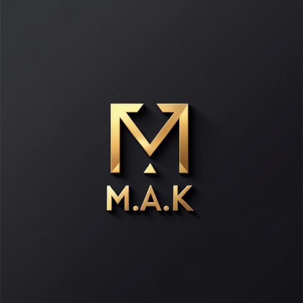

<!-- ================= HEADER ================= -->

<h1 align="center">Hey there, I'm Mohamed Adam 👋</h1>

  

<h3 align="center">
  Future Software Engineer | Technology Enthusiast
</h3>

  

  
  

---

## 👨‍💻 About Me

- 🎓 Computer Science Student at **Université Abdelmalek Essaâdi**, Tétouan.
- 💻 Pursuing a Licence in **Computer Engineering and Software Development**.
- 🚀 Aspiring Software Engineer with a broad interest in Information Technology.
- 🌱 Exploring different technologies and expanding my technical knowledge.
- 💡 Interested in understanding technology as a whole, not limiting myself to a single specialization.
- 🛠️ Learning through programming, experimentation, and personal projects.

---

## 🛠️ Technologies & Tools

### Languages & Web Technologies

  

### Currently Exploring

  

---

## 📌 Featured Projects

*I'm currently developing my programming skills and working towards building more projects. Stay tuned!*

---

## 🎯 My Direction

I'm interested in exploring the different dimensions of Information Technology, including:

- Software Development
- Computer Science Fundamentals
- Web Development
- Operating Systems
- Problem Solving

My goal is to build a strong technical foundation and gradually grow into a well-rounded Software Engineer.

---

## 🤝 Let's Connect

  

---

  

<h3 align="center">
  <i>"Learning never stops. Neither does building."</i>
</h3>

  Designed with curiosity, ambition, and a passion for technology.

